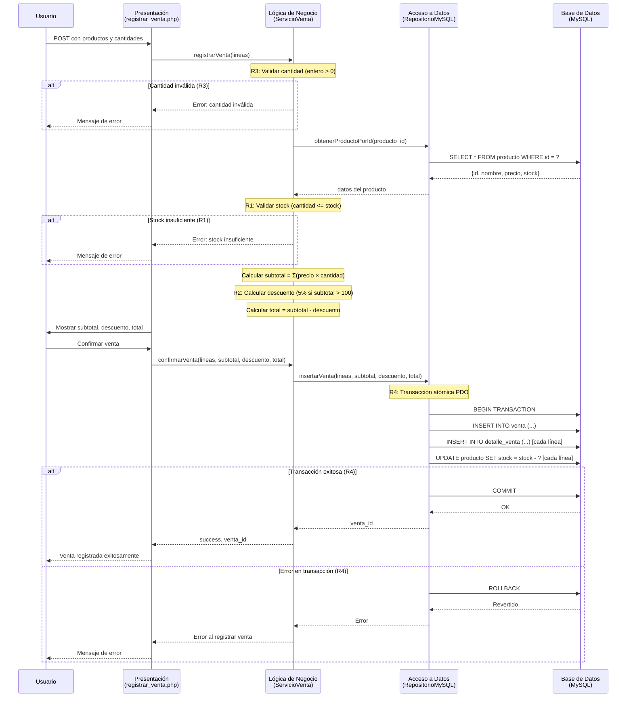

# Design Document: bodega-ventas-registro

## Overview

The bodega-ventas-registro system is a lightweight sales registration application for a small retail store in San Vicente de Cañete, Peru. The system replaces manual pen-and-paper bookkeeping with automated product management, sales recording, volume discount calculation, and real-time inventory updates.

### Key Design Principles

1. **Simplicity First**: No authentication, no framework overhead - the system runs on a single trusted computer
2. **Data Integrity**: All stock updates occur within database transactions to prevent inventory inconsistencies
3. **Business Rule Enforcement**: Validation logic is centralized in service classes to ensure consistent rule application
4. **Testability**: Clear separation between domain logic and data access enables comprehensive unit and property-based testing

### Core Responsibilities

- **Product Management**: Store and retrieve product catalog (name, price, stock)
- **Sales Processing**: Validate sale lines, calculate totals with discounts, persist transactions
- **Stock Control**: Enforce stock availability rules and atomic inventory updates
- **Discount Calculation**: Apply 5% volume discount when subtotal exceeds S/ 100.00

## Architecture

The system follows a **three-layer architecture** for PHP without framework:

```
┌─────────────────────────────────────────────┐
│       Capa de Presentación (archivos.php)   │
│  - Formularios HTML para productos/ventas    │
│  - Mostrar totales, descuentos, confirmación │
│  - registrar_producto.php                    │
│  - registrar_venta.php                       │
└──────────────────┬──────────────────────────┘
                   │ HTTP POST/GET
┌──────────────────▼──────────────────────────┐
│      Capa de Lógica de Negocio (src/)       │
│  - ServicioVenta.php                         │
│    * Validación R1 (stock), R2 (descuento)  │
│    * Validación R3 (cantidad)                │
│    * Cálculo de subtotal, descuento, total   │
│    * NO contiene HTML ni SQL                 │
│    * Testeable con PHPUnit (usa interface)   │
└──────────────────┬──────────────────────────┘
                   │ Llamadas a métodos
┌──────────────────▼──────────────────────────┐
│     Capa de Acceso a Datos (src/)           │
│  - RepositorioMySQL.php                      │
│    * Usa PDO con sentencias preparadas       │
│    * Implementa interface IRepositorio       │
│    * Manejo de transacciones (R4)            │
│    * SELECT, INSERT, UPDATE en producto,     │
│      venta, detalle_venta                    │
└──────────────────┬──────────────────────────┘
                   │ SQL via PDO
┌──────────────────▼──────────────────────────┐
│              MySQL Database                  │
│  - producto: catálogo de productos           │
│  - venta: cabecera de ventas                 │
│  - detalle_venta: líneas de venta            │
└─────────────────────────────────────────────┘
```

### Layer Responsibilities

**Capa de Presentación** (archivos `.php` en raíz o `/vistas/`):
- Archivos PHP con HTML embebido para formularios y vistas
- `registrar_producto.php`: Formulario para registrar productos nuevos
- `registrar_venta.php`: Formulario para registrar venta (selección de productos y cantidades)
- `confirmar_venta.php`: Muestra subtotal, descuento, total antes de confirmar
- Recibe POST/GET, instancia `ServicioVenta`, muestra resultados
- **NO contiene lógica de negocio** - delega todo a la capa de servicios

**Capa de Lógica de Negocio** (`/src/ServicioVenta.php`):
- **Clase `ServicioVenta`**: Orquesta validación, cálculo y persistencia de ventas
- **Responsabilidades**:
  - Validar R1 (stock): Verificar que cantidad <= stock disponible
  - Validar R3 (cantidad): Verificar que cantidad es entero > 0
  - Calcular R2 (descuento): Aplicar 5% si subtotal > S/ 100.00
  - Calcular subtotal = Σ(precio × cantidad)
  - Calcular total = subtotal - descuento
  - Delegar persistencia a `IRepositorio` con transacción (R4)
- **NO contiene HTML ni SQL directo**
- **Testeable con PHPUnit**: Depende de interface `IRepositorio`, permite inyectar mocks/stubs

**Capa de Acceso a Datos** (`/src/RepositorioMySQL.php`):
- **Clase `RepositorioMySQL`**: Implementa interface `IRepositorio`
- **Usa PDO con sentencias preparadas** (protección contra SQL injection)
- **Operaciones**:
  - `obtenerProductoPorId(int $id): ?array` - SELECT de producto
  - `obtenerTodosProductos(): array` - SELECT de todos los productos
  - `insertarProducto(string $nombre, float $precio, int $stock): int` - INSERT en `producto`
  - `insertarVenta(array $lineas, float $subtotal, float $descuento, float $total): int` - INSERT en `venta` y `detalle_venta` + UPDATE `producto.stock`
- **Manejo de transacciones R4**:
  - `PDO::beginTransaction()`
  - `PDO::commit()` / `PDO::rollBack()` en caso de error
- **NO contiene lógica de negocio** - solo persistencia

### Interface IRepositorio (para testabilidad)

Para permitir que `ServicioVenta` sea testeable con PHPUnit sin base de datos:

```php
interface IRepositorio {
    public function obtenerProductoPorId(int $id): ?array;
    public function obtenerTodosProductos(): array;
    public function insertarProducto(string $nombre, float $precio, int $stock): int;
    public function insertarVenta(array $lineas, float $subtotal, float $descuento, float $total): int;
}
```

`RepositorioMySQL` implementa `IRepositorio`.  
En tests PHPUnit, se usa un **mock** o **stub** de `IRepositorio` para probar `ServicioVenta` sin base de datos.

### Transaction Management (R4)

La venta se persiste en una transacción atómica PDO:

```php
$pdo->beginTransaction();
try {
    // 1. INSERT en tabla venta
    $stmt = $pdo->prepare("INSERT INTO venta (fecha, subtotal, descuento, total) VALUES (NOW(), ?, ?, ?)");
    $stmt->execute([$subtotal, $descuento, $total]);
    $ventaId = $pdo->lastInsertId();
    
    // 2. INSERT en tabla detalle_venta + UPDATE stock para cada línea
    foreach ($lineas as $linea) {
        $stmt = $pdo->prepare("INSERT INTO detalle_venta (venta_id, producto_id, cantidad, precio_unitario) VALUES (?, ?, ?, ?)");
        $stmt->execute([$ventaId, $linea['producto_id'], $linea['cantidad'], $linea['precio_unitario']]);
        
        $stmt = $pdo->prepare("UPDATE producto SET stock = stock - ? WHERE id = ?");
        $stmt->execute([$linea['cantidad'], $linea['producto_id']]);
    }
    
    $pdo->commit();
    return $ventaId;
} catch (PDOException $e) {
    $pdo->rollBack();
    throw $e;
}
```

### Sequence Diagram: Registrar Venta

El siguiente diagrama Mermaid muestra el flujo de registro de venta, indicando dónde se valida cada regla de negocio (R1-R4):



**Resumen de validación de reglas por capa**:
- **R1 (Stock)**: Validada en `ServicioVenta` (lógica de negocio) antes de persistir
- **R2 (Descuento)**: Calculada en `ServicioVenta` (lógica de negocio)
- **R3 (Cantidad)**: Validada en `ServicioVenta` (lógica de negocio) al inicio
- **R4 (Actualización atómica)**: Ejecutada en `RepositorioMySQL` (acceso a datos) con transacción PDO

## Components and Interfaces

### 1. IRepositorio (Interface)

**Purpose**: Abstraction for data access to enable testability

**Interface Definition**:
```php
interface IRepositorio {
    /**
     * Obtiene un producto por su ID.
     * 
     * @param int $id ID del producto
     * @return array|null ['id' => int, 'nombre' => string, 'precio' => float, 'stock' => int] o null
     */
    public function obtenerProductoPorId(int $id): ?array;
    
    /**
     * Obtiene todos los productos.
     * 
     * @return array [['id' => int, 'nombre' => string, 'precio' => float, 'stock' => int], ...]
     */
    public function obtenerTodosProductos(): array;
    
    /**
     * Inserta un nuevo producto.
     * 
     * @param string $nombre Nombre del producto
     * @param float $precio Precio unitario (debe ser > 0)
     * @param int $stock Stock inicial (debe ser >= 0)
     * @return int ID del producto insertado
     */
    public function insertarProducto(string $nombre, float $precio, int $stock): int;
    
    /**
     * Inserta una venta con sus líneas y actualiza stock en transacción atómica.
     * 
     * @param array $lineas [['producto_id' => int, 'cantidad' => int, 'precio_unitario' => float], ...]
     * @param float $subtotal Subtotal de la venta
     * @param float $descuento Descuento aplicado
     * @param float $total Total de la venta
     * @return int ID de la venta insertada
     * @throws Exception Si la transacción falla
     */
    public function insertarVenta(array $lineas, float $subtotal, float $descuento, float $total): int;
}
```

**Purpose**: Esta interface permite que `ServicioVenta` sea testeable con PHPUnit sin base de datos. En tests se usa un mock/stub de `IRepositorio`, en producción se usa `RepositorioMySQL`.

### 2. ServicioVenta

**Purpose**: Lógica de negocio para validación, cálculo y registro de ventas. **NO contiene HTML ni SQL**.

**Public Interface**:
```php
class ServicioVenta {
    private IRepositorio $repositorio;
    
    public function __construct(IRepositorio $repositorio) {
        $this->repositorio = $repositorio;
    }
    
    /**
     * Valida y registra una venta con múltiples líneas.
     * 
     * @param array $lineas [['producto_id' => int, 'cantidad' => mixed], ...]
     * @return array ['success' => bool, 'venta_id' => int|null, 'error' => string|null, 
     *                'subtotal' => float, 'descuento' => float, 'total' => float]
     */
    public function registrarVenta(array $lineas): array;
    
    /**
     * Calcula subtotal, descuento y total para líneas de venta dadas.
     * 
     * @param array $lineas [['producto_id' => int, 'cantidad' => int], ...]
     * @return array ['subtotal' => float, 'descuento' => float, 'total' => float]
     */
    public function calcularTotales(array $lineas): array;
}
```

**Key Responsibilities**:
- **R3 - Validar cantidad**: Rechazar si cantidad no es entero o si cantidad <= 0
- **R1 - Validar stock**: Consultar stock vía `$repositorio->obtenerProductoPorId()`, rechazar si cantidad > stock
- **Calcular subtotal**: subtotal = Σ(precio × cantidad) para todas las líneas
- **R2 - Calcular descuento**: `descuento = (subtotal > 100.00) ? subtotal * 0.05 : 0.00`
- **Calcular total**: total = subtotal - descuento
- **Persistir venta**: Delegar a `$repositorio->insertarVenta()` (que ejecuta R4 en transacción)

**Validation Flow**:
```php
public function registrarVenta(array $lineas): array {
    // R3: Validar cada cantidad
    foreach ($lineas as $linea) {
        if (!is_int($linea['cantidad']) || $linea['cantidad'] <= 0) {
            return ['success' => false, 'error' => 'CANTIDAD_INVALIDA', 
                    'mensaje' => 'La cantidad debe ser un entero mayor a cero'];
        }
    }
    
    // R1: Validar stock y obtener precios
    $lineasConPrecios = [];
    foreach ($lineas as $linea) {
        $producto = $this->repositorio->obtenerProductoPorId($linea['producto_id']);
        if (!$producto) {
            return ['success' => false, 'error' => 'PRODUCTO_NO_EXISTE'];
        }
        if ($linea['cantidad'] > $producto['stock']) {
            return ['success' => false, 'error' => 'STOCK_INSUFICIENTE',
                    'mensaje' => "Stock insuficiente para {$producto['nombre']} (disponible: {$producto['stock']})"];
        }
        $lineasConPrecios[] = [
            'producto_id' => $linea['producto_id'],
            'cantidad' => $linea['cantidad'],
            'precio_unitario' => $producto['precio']
        ];
    }
    
    // Calcular totales
    $totales = $this->calcularTotales($lineasConPrecios);
    
    // R4: Persistir en transacción (delegado a repositorio)
    try {
        $ventaId = $this->repositorio->insertarVenta(
            $lineasConPrecios, 
            $totales['subtotal'], 
            $totales['descuento'], 
            $totales['total']
        );
        return array_merge(['success' => true, 'venta_id' => $ventaId], $totales);
    } catch (Exception $e) {
        return ['success' => false, 'error' => 'TRANSACCION_FALLIDA', 
                'mensaje' => 'Error al confirmar venta: ' . $e->getMessage()];
    }
}

public function calcularTotales(array $lineas): array {
    $subtotal = 0.0;
    foreach ($lineas as $linea) {
        $subtotal += $linea['precio_unitario'] * $linea['cantidad'];
    }
    
    // R2: Descuento
    $descuento = ($subtotal > 100.00) ? round($subtotal * 0.05, 2) : 0.00;
    $total = round($subtotal - $descuento, 2);
    
    return [
        'subtotal' => $subtotal,
        'descuento' => $descuento,
        'total' => $total
    ];
}
```

### 3. RepositorioMySQL

**Purpose**: Implementación de `IRepositorio` usando PDO con sentencias preparadas. Ejecuta operaciones CRUD y transacciones atómicas (R4).

**Public Interface**:
```php
class RepositorioMySQL implements IRepositorio {
    private PDO $pdo;
    
    public function __construct(PDO $pdo) {
        $this->pdo = $pdo;
    }
    
    public function obtenerProductoPorId(int $id): ?array { /* ... */ }
    public function obtenerTodosProductos(): array { /* ... */ }
    public function insertarProducto(string $nombre, float $precio, int $stock): int { /* ... */ }
    public function insertarVenta(array $lineas, float $subtotal, float $descuento, float $total): int { /* ... */ }
}
```

**Key Responsibilities**:
- **Usar PDO con sentencias preparadas** para protección contra SQL injection
- **R4 - Transacción atómica**: `insertarVenta()` usa `PDO::beginTransaction()` / `commit()` / `rollBack()`
- **NO contiene lógica de negocio** - solo persistencia de datos

**Implementation of insertarVenta (R4)**:
```php
public function insertarVenta(array $lineas, float $subtotal, float $descuento, float $total): int {
    $this->pdo->beginTransaction();
    try {
        // 1. Insertar cabecera de venta
        $stmt = $this->pdo->prepare(
            "INSERT INTO venta (fecha, subtotal, descuento, total) VALUES (NOW(), ?, ?, ?)"
        );
        $stmt->execute([$subtotal, $descuento, $total]);
        $ventaId = (int)$this->pdo->lastInsertId();
        
        // 2. Insertar detalle y actualizar stock para cada línea
        $stmtDetalle = $this->pdo->prepare(
            "INSERT INTO detalle_venta (venta_id, producto_id, cantidad, precio_unitario) VALUES (?, ?, ?, ?)"
        );
        $stmtStock = $this->pdo->prepare(
            "UPDATE producto SET stock = stock - ? WHERE id = ?"
        );
        
        foreach ($lineas as $linea) {
            $stmtDetalle->execute([
                $ventaId, 
                $linea['producto_id'], 
                $linea['cantidad'], 
                $linea['precio_unitario']
            ]);
            $stmtStock->execute([$linea['cantidad'], $linea['producto_id']]);
        }
        
        $this->pdo->commit();
        return $ventaId;
    } catch (PDOException $e) {
        $this->pdo->rollBack();
        throw new Exception("Error en transacción de venta: " . $e->getMessage());
    }
}
```

**PDO Configuration**:
- Host: `localhost`
- Database: `bodega_dona_rosa`
- Charset: `utf8mb4`
- Error mode: `PDO::ERRMODE_EXCEPTION`
- User/password from `config/database.php` (not hardcoded)

## Data Models

### Database Schema

```sql
CREATE DATABASE IF NOT EXISTS bodega_dona_rosa 
CHARACTER SET utf8mb4 COLLATE utf8mb4_unicode_ci;

USE bodega_dona_rosa;

-- Tabla producto (catálogo de productos)
CREATE TABLE producto (
    id INT AUTO_INCREMENT PRIMARY KEY,
    nombre VARCHAR(255) NOT NULL,
    precio DECIMAL(10, 2) NOT NULL,
    stock INT NOT NULL DEFAULT 0,
    fecha_registro TIMESTAMP DEFAULT CURRENT_TIMESTAMP,
    CONSTRAINT chk_precio_positivo CHECK (precio > 0),
    CONSTRAINT chk_stock_no_negativo CHECK (stock >= 0),
    INDEX idx_nombre (nombre)
) ENGINE=InnoDB;

-- Tabla venta (cabecera de venta)
CREATE TABLE venta (
    id INT AUTO_INCREMENT PRIMARY KEY,
    fecha TIMESTAMP DEFAULT CURRENT_TIMESTAMP,
    subtotal DECIMAL(10, 2) NOT NULL,
    descuento DECIMAL(10, 2) NOT NULL DEFAULT 0.00,
    total DECIMAL(10, 2) NOT NULL,
    CONSTRAINT chk_subtotal_no_negativo CHECK (subtotal >= 0),
    CONSTRAINT chk_descuento_no_negativo CHECK (descuento >= 0),
    CONSTRAINT chk_total_no_negativo CHECK (total >= 0),
    INDEX idx_fecha (fecha)
) ENGINE=InnoDB;

-- Tabla detalle_venta (líneas de venta)
CREATE TABLE detalle_venta (
    id INT AUTO_INCREMENT PRIMARY KEY,
    venta_id INT NOT NULL,
    producto_id INT NOT NULL,
    cantidad INT NOT NULL,
    precio_unitario DECIMAL(10, 2) NOT NULL,
    CONSTRAINT chk_cantidad_positiva CHECK (cantidad > 0),
    CONSTRAINT chk_precio_unitario_positivo CHECK (precio_unitario > 0),
    FOREIGN KEY (venta_id) REFERENCES venta(id) ON DELETE CASCADE,
    FOREIGN KEY (producto_id) REFERENCES producto(id) ON DELETE RESTRICT,
    INDEX idx_venta (venta_id),
    INDEX idx_producto (producto_id)
) ENGINE=InnoDB;
```

**Table Descriptions**:

**producto**:
- `id`: Primary key, auto-increment
- `nombre`: Product name (VARCHAR 255, NOT NULL)
- `precio`: Unit price (DECIMAL 10,2, NOT NULL, CHECK > 0)
- `stock`: Available quantity (INT, NOT NULL, DEFAULT 0, CHECK >= 0)
- `fecha_registro`: Registration timestamp (auto)
- **Constraints**: Precio must be > 0, stock must be >= 0

**venta**:
- `id`: Primary key, auto-increment
- `fecha`: Sale timestamp (auto)
- `subtotal`: Sum of all line items before discount (DECIMAL 10,2, NOT NULL)
- `descuento`: Discount amount applied (DECIMAL 10,2, NOT NULL, DEFAULT 0)
- `total`: Final total after discount (DECIMAL 10,2, NOT NULL)
- **Constraints**: All monetary values must be >= 0

**detalle_venta**:
- `id`: Primary key, auto-increment
- `venta_id`: Foreign key to `venta.id` (CASCADE on delete)
- `producto_id`: Foreign key to `producto.id` (RESTRICT on delete)
- `cantidad`: Quantity sold (INT, NOT NULL, CHECK > 0)
- `precio_unitario`: Unit price at time of sale (DECIMAL 10,2, NOT NULL, CHECK > 0)
- **Constraints**: Cantidad must be > 0, precio_unitario must be > 0
- **Foreign Keys**: 
  - `venta_id` CASCADE (if venta deleted, detalle deleted)
  - `producto_id` RESTRICT (cannot delete producto if referenced in detalle)

### PHP Domain Model Classes (Optional)

For cleaner code organization, you can use lightweight value objects:

**Producto**:
```php
class Producto {
    public function __construct(
        public readonly int $id,
        public readonly string $nombre,
        public readonly float $precio,
        public readonly int $stock
    ) {
        if ($precio <= 0) {
            throw new InvalidArgumentException("Precio debe ser mayor a cero");
        }
        if ($stock < 0) {
            throw new InvalidArgumentException("Stock no puede ser negativo");
        }
    }
}
```

**DetalleVenta**:
```php
class DetalleVenta {
    public function __construct(
        public readonly int $productoId,
        public readonly int $cantidad,
        public readonly float $precioUnitario
    ) {}
    
    public function calcularSubtotal(): float {
        return $this->cantidad * $this->precioUnitario;
    }
}
```

**Venta**:
```php
class Venta {
    /** @param DetalleVenta[] $detalles */
    public function __construct(
        public readonly int $id,
        public readonly array $detalles,
        public readonly float $subtotal,
        public readonly float $descuento,
        public readonly float $total,
        public readonly DateTimeImmutable $fecha
    ) {}
}
```

### Data Validation Constraints Summary

**Database Level (enforced by MySQL)**:
- `producto.precio > 0` (CHECK constraint)
- `producto.stock >= 0` (CHECK constraint)
- `detalle_venta.cantidad > 0` (CHECK constraint)
- `detalle_venta.precio_unitario > 0` (CHECK constraint)
- Foreign key constraints prevent orphaned records

**Application Level (enforced by ServicioVenta)**:
- **R1**: Stock availability - `cantidad <= stock disponible`
- **R3**: Quantity validation - `cantidad` must be integer > 0 (no decimals, no negatives, no zero)
- **R2**: Discount calculation - apply 5% if subtotal > S/ 100.00
- **R4**: Atomic transaction - all inserts/updates in single PDO transaction

## Correctness Properties

*A property is a characteristic or behavior that should hold true across all valid executions of a system—essentially, a formal statement about what the system should do. Properties serve as the bridge between human-readable specifications and machine-verifiable correctness guarantees.*

Before writing the correctness properties, I need to analyze each acceptance criterion for testability using the prework tool:


### Property Reflection

After analyzing all acceptance criteria in the prework, I've identified the following properties and potential redundancies:

**Identified Properties:**
1. Product registration round-trip (1.2) - persistence
2. Positive price acceptance (1.3) - validation
3. Non-negative stock acceptance (1.4) - validation
4. Stock validation rejects excess quantity (2.1) - validation
5. Negative quantity rejection (2.4) - validation
6. Decimal quantity rejection (2.5) - validation
7. Multiple sale lines acceptance (3.1) - structure
8. Subtotal calculation correctness (3.3) - calculation
9. Discount calculation for subtotal > 100 (4.1) - calculation
10. Discount calculation for subtotal < 100 (4.3) - calculation
11. Total calculation correctness (4.4) - calculation
12. Stock reduction after sale (5.1) - side effect
13. Stock persistence after sale (5.3) - persistence

**Redundancy Analysis:**

- **Properties 9, 10, and 11 can be combined**: Instead of testing discount calculation and total calculation separately, we can create one comprehensive property that tests the entire calculation pipeline: for any set of sale lines, verify subtotal, discount (based on threshold), and total are all calculated correctly. This single property validates requirements 3.3, 4.1, 4.3, and 4.4.

- **Properties 12 and 13 can be combined**: Both test that stock is correctly updated after a sale. Instead of separate properties for "stock is reduced" and "stock persists", we can have one property: for any valid sale, after confirmation, querying the database should show stock reduced by the quantity sold. This validates both the reduction and persistence in one test.

- **Properties 2 and 3 test valid inputs**: These can be combined into one property about product creation accepting valid inputs (price > 0, stock >= 0).

- **Properties 5 and 6 test invalid quantity inputs**: These can be combined into one property about quantity validation rejecting invalid inputs (negative, decimal).

**Final Property Set After Reflection:**

1. **Product registration preserves data** (combines persistence round-trip)
2. **Product validation accepts valid inputs** (combines price > 0 and stock >= 0)
3. **Stock validation rejects insufficient stock** (stock availability rule)
4. **Quantity validation rejects invalid quantities** (combines negative and decimal rejection)
5. **Sale calculation correctness** (combines subtotal, discount, and total calculation)
6. **Multiple sale lines are processed correctly** (variable line count)
7. **Stock updates persist after sale confirmation** (combines stock reduction and persistence)

### Property 1: Product Registration Preserves Data

*For any* valid product with name, price > 0, and stock >= 0, registering the product then retrieving it by ID should return the same name, price, and stock values.

**Validates: Requirements 1.2**

### Property 2: Product Validation Accepts Valid Inputs

*For any* product with price > 0 and stock >= 0, the product registration should succeed without validation errors.

**Validates: Requirements 1.3, 1.4**

### Property 3: Stock Validation Rejects Insufficient Stock

*For any* product and quantity where quantity > available stock, attempting to create a sale line should be rejected with a stock availability error.

**Validates: Requirements 2.1**

### Property 4: Quantity Validation Rejects Invalid Quantities

*For any* quantity value that is negative, zero, or a non-integer (decimal), attempting to create a sale line should be rejected with a quantity validation error.

**Validates: Requirements 2.3, 2.4, 2.5**

### Property 5: Sale Calculation Correctness

*For any* set of valid sale lines with products and quantities, the calculated subtotal should equal Σ(price × quantity), the discount should equal 0 if subtotal <= 100.00 or subtotal × 0.05 if subtotal > 100.00, and the total should equal subtotal - discount.

**Validates: Requirements 3.3, 4.1, 4.3, 4.4**

### Property 6: Multiple Sale Lines Processed Correctly

*For any* number N of valid sale lines (1 <= N <= 100), creating a sale with N lines should succeed, and the subtotal should correctly sum all N line items.

**Validates: Requirements 3.1**

### Property 7: Stock Updates Persist After Sale Confirmation

*For any* valid sale with products and quantities, after successfully confirming the sale, querying each product's stock from the database should show the stock reduced by exactly the quantity sold for that product.

**Validates: Requirements 5.1, 5.3**

## Error Handling

### Validation Errors

**Product Registration Errors**:
- `PRECIO_INVALIDO`: Price is zero, negative, or not numeric
- `STOCK_INVALIDO`: Stock is negative or not an integer
- `NOMBRE_VACIO`: Product name is empty or null

**Sale Line Validation Errors**:
- `CANTIDAD_INVALIDA`: Quantity is zero, negative, or non-integer (R3)
- `STOCK_INSUFICIENTE`: Quantity exceeds available stock (R1)
- `PRODUCTO_NO_EXISTE`: Product ID not found in database

**Sale Processing Errors**:
- `VENTA_VACIA`: Sale submitted with zero lines
- `LINEA_INVALIDA`: One or more lines failed validation

### Error Response Format

All service methods return consistent error structures:

```php
[
    'success' => false,
    'error' => 'ERROR_CODE',
    'mensaje' => 'Human-readable error message in Spanish',
    'campo' => 'field_name' // optional, for field-specific errors
]
```

### Transaction Rollback Scenarios (R4)

The following errors trigger automatic transaction rollback in `VentaRepository::guardarVentaConLineas()`:

1. **Insert failure on `ventas` table**: Database constraint violation
2. **Insert failure on `lineas_venta` table**: Foreign key violation or constraint error
3. **Update failure on `productos` table**: Concurrent stock modification, constraint violation
4. **MySQL error during transaction**: Connection loss, deadlock, timeout

Rollback flow:
```php
try {
    $db->beginTransaction();
    // ... insert operations ...
    $db->commit();
    return ['success' => true, 'venta_id' => $id];
} catch (mysqli_sql_exception $e) {
    $db->rollback();
    return ['success' => false, 'error' => 'TRANSACCION_FALLIDA', 
            'mensaje' => 'Error al confirmar venta: ' . $e->getMessage()];
}
```

### User-Facing Error Messages

Error messages displayed in UI are in Spanish and user-friendly:

| Error Code | User Message |
|------------|--------------|
| `PRECIO_INVALIDO` | "El precio debe ser mayor a cero" |
| `STOCK_INVALIDO` | "El stock debe ser un número entero mayor o igual a cero" |
| `CANTIDAD_INVALIDA` | "La cantidad debe ser un número entero mayor a cero" |
| `STOCK_INSUFICIENTE` | "No hay suficiente stock disponible (disponible: X)" |
| `PRODUCTO_NO_EXISTE` | "El producto seleccionado no existe" |
| `VENTA_VACIA` | "Debe agregar al menos un producto a la venta" |
| `TRANSACCION_FALLIDA` | "Error al procesar la venta. Intente nuevamente" |

## Testing Strategy

### Dual Testing Approach

The bodega-ventas-registro system will use **both unit tests and property-based tests** for comprehensive coverage:

- **Unit tests**: Verify specific examples, edge cases, and integration points
- **Property-based tests**: Verify universal properties across randomized inputs

### Property-Based Testing Configuration

**Library Selection**: [Eris](https://github.com/giorgiosironi/eris) - property-based testing for PHP
- PHP native solution compatible with PHPUnit
- Supports arbitrary value generation (integers, floats, strings, arrays)
- Integrates seamlessly with existing PHPUnit test suites

**Test Configuration**:
- Minimum **100 iterations per property test** (required due to randomization)
- Each property test must include a comment tag referencing the design property:
  ```php
  /**
   * Feature: bodega-ventas-registro, Property 1: Product Registration Preserves Data
   */
  public function testProductRegistrationPreservesData() { ... }
  ```

### Testability: ServicioVenta with Mocks

**CRITICAL**: `ServicioVenta` is designed to be testable with PHPUnit **without a database**.

**Approach**:
1. `ServicioVenta` depends on `IRepositorio` interface (not concrete `RepositorioMySQL`)
2. In tests, use **PHPUnit mock** or **stub** of `IRepositorio`
3. Mock returns predefined data without touching database

**Example Test with Mock**:
```php
use PHPUnit\Framework\TestCase;

class ServicioVentaTest extends TestCase {
    /**
     * Feature: bodega-ventas-registro, Property 3: Stock Validation Rejects Insufficient Stock
     */
    public function testStockValidationRejectsInsufficientStock() {
        // Mock repository
        $repoMock = $this->createMock(IRepositorio::class);
        $repoMock->method('obtenerProductoPorId')
                 ->willReturn(['id' => 1, 'nombre' => 'Arroz', 'precio' => 5.50, 'stock' => 10]);
        
        $servicio = new ServicioVenta($repoMock);
        
        // Try to sell 15 units when only 10 available (R1)
        $result = $servicio->registrarVenta([
            ['producto_id' => 1, 'cantidad' => 15]
        ]);
        
        $this->assertFalse($result['success']);
        $this->assertEquals('STOCK_INSUFICIENTE', $result['error']);
    }
}
```

### Property Test Implementation Guide

Each correctness property maps to a single property-based test:

**Property 1: Product Registration Preserves Data** (with database)
```php
use Eris\Generator;

/**
 * Feature: bodega-ventas-registro, Property 1: Product Registration Preserves Data
 */
public function testProductRegistrationPreservesData() {
    $this->forAll(
        Generator::string()->suchthat(fn($s) => strlen($s) > 0 && strlen($s) <= 255), // nombre
        Generator::float(0.01, 9999.99), // precio > 0
        Generator::int(0, 9999) // stock >= 0
    )->then(function($nombre, $precio, $stock) {
        $pdo = $this->getTestDatabaseConnection();
        $repo = new RepositorioMySQL($pdo);
        
        $productoId = $repo->insertarProducto($nombre, $precio, $stock);
        $retrieved = $repo->obtenerProductoPorId($productoId);
        
        $this->assertEquals($nombre, $retrieved['nombre']);
        $this->assertEquals($precio, $retrieved['precio'], '', 0.01);
        $this->assertEquals($stock, $retrieved['stock']);
    });
}
```

**Property 3: Stock Validation Rejects Insufficient Stock** (with mock - no database)
```php
/**
 * Feature: bodega-ventas-registro, Property 3: Stock Validation Rejects Insufficient Stock
 */
public function testStockValidationRejectsInsufficientStock() {
    $this->forAll(
        Generator::int(1, 100), // current stock
        Generator::int(1, 200)  // requested quantity
    )->when(function($stock, $cantidad) {
        return $cantidad > $stock; // only test when insufficient
    })->then(function($stock, $cantidad) {
        // Mock repository with known stock
        $repoMock = $this->createMock(IRepositorio::class);
        $repoMock->method('obtenerProductoPorId')
                 ->willReturn(['id' => 1, 'nombre' => 'Test', 'precio' => 10.0, 'stock' => $stock]);
        
        $servicio = new ServicioVenta($repoMock);
        $result = $servicio->registrarVenta([
            ['producto_id' => 1, 'cantidad' => $cantidad]
        ]);
        
        $this->assertFalse($result['success']);
        $this->assertEquals('STOCK_INSUFICIENTE', $result['error']);
    });
}
```

**Property 4: Quantity Validation Rejects Invalid Quantities** (with mock - no database)
```php
/**
 * Feature: bodega-ventas-registro, Property 4: Quantity Validation Rejects Invalid Quantities
 */
public function testQuantityValidationRejectsInvalidQuantities() {
    $invalidQuantities = [
        -5,      // negative
        0,       // zero
        1.5,     // decimal
        -10.3,   // negative decimal
        '5'      // string (should fail is_int check)
    ];
    
    foreach ($invalidQuantities as $cantidad) {
        $repoMock = $this->createMock(IRepositorio::class);
        $servicio = new ServicioVenta($repoMock);
        
        $result = $servicio->registrarVenta([
            ['producto_id' => 1, 'cantidad' => $cantidad]
        ]);
        
        $this->assertFalse($result['success']);
        $this->assertEquals('CANTIDAD_INVALIDA', $result['error']);
    }
}
```

**Property 5: Sale Calculation Correctness** (with mock - no database)
```php
/**
 * Feature: bodega-ventas-registro, Property 5: Sale Calculation Correctness
 */
public function testSaleCalculationCorrectness() {
    $this->forAll(
        Generator::seq(Generator::associative([
            'producto_id' => Generator::int(1, 100),
            'cantidad' => Generator::int(1, 50)
        ]))->suchthat(fn($lines) => count($lines) > 0 && count($lines) <= 20)
    )->then(function($lineas) {
        // Assign random prices
        $lineasConPrecios = [];
        $repoMock = $this->createMock(IRepositorio::class);
        
        foreach ($lineas as $linea) {
            $precio = mt_rand(100, 99999) / 100.0; // Random price 1.00 - 999.99
            $lineasConPrecios[] = [
                'producto_id' => $linea['producto_id'],
                'cantidad' => $linea['cantidad'],
                'precio_unitario' => $precio
            ];
            
            // Mock repository to return product with enough stock and this price
            $repoMock->method('obtenerProductoPorId')
                     ->with($linea['producto_id'])
                     ->willReturn([
                         'id' => $linea['producto_id'],
                         'nombre' => "Producto {$linea['producto_id']}",
                         'precio' => $precio,
                         'stock' => 1000 // Sufficient stock
                     ]);
        }
        
        // Calculate expected values
        $expectedSubtotal = array_sum(array_map(
            fn($l) => $l['precio_unitario'] * $l['cantidad'], 
            $lineasConPrecios
        ));
        $expectedDescuento = ($expectedSubtotal > 100.00) 
            ? round($expectedSubtotal * 0.05, 2) 
            : 0.00;
        $expectedTotal = round($expectedSubtotal - $expectedDescuento, 2);
        
        $servicio = new ServicioVenta($repoMock);
        $result = $servicio->calcularTotales($lineasConPrecios);
        
        $this->assertEquals($expectedSubtotal, $result['subtotal'], '', 0.01);
        $this->assertEquals($expectedDescuento, $result['descuento'], '', 0.01);
        $this->assertEquals($expectedTotal, $result['total'], '', 0.01);
    });
}
```

**Property 7: Stock Updates Persist After Sale Confirmation** (with database - integration test)
```php
/**
 * Feature: bodega-ventas-registro, Property 7: Stock Updates Persist After Sale Confirmation
 */
public function testStockUpdatesPersistAfterSaleConfirmation() {
    $this->forAll(
        Generator::int(10, 100), // initial stock
        Generator::int(1, 9)     // quantity to sell (less than stock)
    )->then(function($stockInicial, $cantidad) {
        $pdo = $this->getTestDatabaseConnection();
        $repo = new RepositorioMySQL($pdo);
        
        // Create product with known stock
        $productoId = $repo->insertarProducto('Test', 10.0, $stockInicial);
        
        // Register sale
        $servicio = new ServicioVenta($repo);
        $result = $servicio->registrarVenta([
            ['producto_id' => $productoId, 'cantidad' => $cantidad]
        ]);
        
        $this->assertTrue($result['success']);
        
        // Verify stock was reduced
        $producto = $repo->obtenerProductoPorId($productoId);
        $this->assertEquals($stockInicial - $cantidad, $producto['stock']);
    });
}
```

### Unit Test Coverage

Unit tests complement property tests by covering:

1. **Specific Examples** (Requirements 1.1, 3.2):
   - Product registration with typical values: "Arroz Costeño", S/ 5.50, 100 units
   - Sale with 3 specific products totaling exactly S/ 100.00 (no discount boundary)
   - Sale with 1 product totaling S/ 101.00 (discount applies: S/ 5.05)

2. **Edge Cases** (Requirements 2.2, 4.2):
   - Sale line quantity exactly equals available stock (should succeed, stock becomes 0)
   - Subtotal exactly S/ 100.00 (no discount applied)
   - Sale line quantity is zero (rejected)
   - Empty sale (zero lines) is rejected

3. **Integration Tests** (Requirements 5.2):
   - Transaction rollback on stock update failure (simulate constraint violation)
   - Concurrent sale attempts on same product (test race condition handling)

4. **Error Path Tests**:
   - Product registration with invalid price (zero, negative, non-numeric)
   - Product registration with invalid stock (negative, decimal)
   - Sale line with non-existent product ID
   - Sale line with decimal quantity (1.5 units)

### Test Data Management

**Database Setup for Tests**:
- Use separate test database: `bodega_dona_rosa_test`
- PHPUnit `setUp()`: Create tables, truncate existing data
- PHPUnit `tearDown()`: Truncate tables or drop/recreate database
- Use PDO transactions in tests for isolation when possible

**Test Database Configuration**:
```php
protected function getTestDatabaseConnection(): PDO {
    $pdo = new PDO(
        'mysql:host=localhost;dbname=bodega_dona_rosa_test;charset=utf8mb4',
        'root',
        '',
        [
            PDO::ATTR_ERRMODE => PDO::ERRMODE_EXCEPTION,
            PDO::ATTR_DEFAULT_FETCH_MODE => PDO::FETCH_ASSOC
        ]
    );
    return $pdo;
}
```

### Test Execution

**Run all tests**:
```bash
php phpunit.phar
```

**Run only unit tests** (no database):
```bash
php phpunit.phar --group unit
```

**Run only integration tests** (with database):
```bash
php phpunit.phar --group integration
```

**Property test minimum iterations**: Configure Eris to run 100 iterations per test:
```php
use Eris\TestTrait;

class ServicioVentaTest extends TestCase {
    use TestTrait;
    
    protected function minimumEvaluationRatio(): float {
        return 0.5; // At least 50% of generated inputs must satisfy preconditions
    }
}
```

### Coverage Goals

- **Line Coverage**: > 90% for `ServicioVenta` (business logic)
- **Branch Coverage**: > 85% for business logic paths
- **Property Coverage**: 100% (all 7 correctness properties implemented as tests)
- **Requirement Coverage**: 100% (all acceptance criteria validated by unit or property tests)

### Test Organization

```
tests/
├── unit/
│   ├── ServicioVentaTest.php              # Property tests 3, 4, 5 (with mocks)
│   ├── CalculosTest.php                   # Unit tests for edge cases (discount boundary)
│   └── ValidacionTest.php                 # Unit tests for validation error messages
├── integration/
│   ├── RepositorioMySQLTest.php           # Property test 1 (with database)
│   ├── VentaIntegracionTest.php           # Property test 7 (with database)
│   └── TransaccionRollbackTest.php        # Transaction atomicity (Req 5.2)
└── bootstrap.php                          # Test database setup
```

**Key Testing Principles**:
1. **ServicioVenta is testable without database** (uses `IRepositorio` interface)
2. **Property tests verify universal properties** (100+ iterations with random data)
3. **Unit tests verify specific examples and edge cases**
4. **Integration tests verify database operations and transactions**

---

## Summary

This design document specifies a **three-layer architecture for PHP without framework** for the bodega-ventas-registro system:

**Capa de Presentación**: Archivos `.php` con HTML embebido (formularios y vistas)
- `registrar_producto.php`, `registrar_venta.php`, `confirmar_venta.php`
- Delega toda lógica de negocio a `ServicioVenta`

**Capa de Lógica de Negocio**: Clase `ServicioVenta` en `/src/`
- Valida R1 (stock), R2 (descuento), R3 (cantidad)
- **NO contiene HTML ni SQL directo**
- **Testeable con PHPUnit sin base de datos** (depende de `IRepositorio` interface, usa mocks/stubs en tests)

**Capa de Acceso a Datos**: Clase `RepositorioMySQL` en `/src/`
- Implementa `IRepositorio` interface
- **Usa PDO con sentencias preparadas** (protección SQL injection)
- Ejecuta R4 (transacción atómica) con `PDO::beginTransaction()` / `commit()` / `rollBack()`

**Modelo de Datos**: Tres tablas MySQL con InnoDB
- `producto` (id, nombre, precio, stock)
- `venta` (id, fecha, subtotal, descuento, total)
- `detalle_venta` (id, venta_id, producto_id, cantidad, precio_unitario)

**Diagrama de Secuencia**: Muestra flujo de "Registrar Venta" con validación de reglas:
- **R1 (Stock)**: Validada en `ServicioVenta` antes de persistir
- **R2 (Descuento)**: Calculada en `ServicioVenta` (5% si subtotal > S/ 100.00)
- **R3 (Cantidad)**: Validada en `ServicioVenta` al inicio (entero > 0)
- **R4 (Actualización atómica)**: Ejecutada en `RepositorioMySQL` con transacción PDO

**Testabilidad Crítica**:
- `ServicioVenta` usa interface `IRepositorio` (no clase concreta)
- Tests unitarios usan **PHPUnit mocks/stubs** de `IRepositorio` sin base de datos
- Tests de integración usan `RepositorioMySQL` real con base de datos de test

**Property-Based Testing**: Siete propiedades de corrección implementadas con **Eris**:
1. Product registration preserves data (with DB)
2. Product validation accepts valid inputs
3. Stock validation rejects insufficient stock (with mock)
4. Quantity validation rejects invalid quantities (with mock)
5. Sale calculation correctness (with mock)
6. Multiple sale lines processed correctly
7. Stock updates persist after sale confirmation (with DB)

**Technology Stack**:
- PHP 8 con tipado estricto
- MySQL 8 con InnoDB (soporte transaccional)
- **PDO** para acceso a datos (sentencias preparadas)
- PHPUnit + **Eris** para tests unitarios y property-based testing
- **Interface `IRepositorio`** para testabilidad sin base de datos

The design addresses all five requirements with explicit validation of 13 acceptance criteria through a combination of unit tests (with mocks) and property-based tests, ensuring `ServicioVenta` is fully testable without database dependencies.
