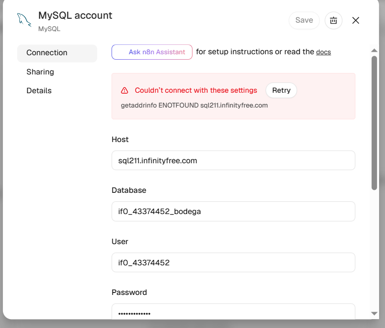

# Intento de conexión MySQL desde n8n

**Host:** sql211.infinityfree.com:3306 · **Base:** if0_43374452_bodega · **Usuario:** if0_43374452
**Nodo:** MySQL Tool (credencial "MySQL account") en el workflow "Consulta bodega – Rojas v3 MySQL"
**Consulta prevista:** `SELECT nombre, precio, stock FROM producto`

**Error exacto:**
```
Couldn't connect with these settings
getaddrinfo ENOTFOUND sql211.infinityfree.com
```



## Análisis
## Análisis
1. El host sql211.infinityfree.com solo existe dentro de la red de InfinityFree, por eso sale ENOTFOUND...
2. Una API REST, es decir, un endpoint PHP en el mismo hosting...
3. Las credenciales quedan solo en el servidor.